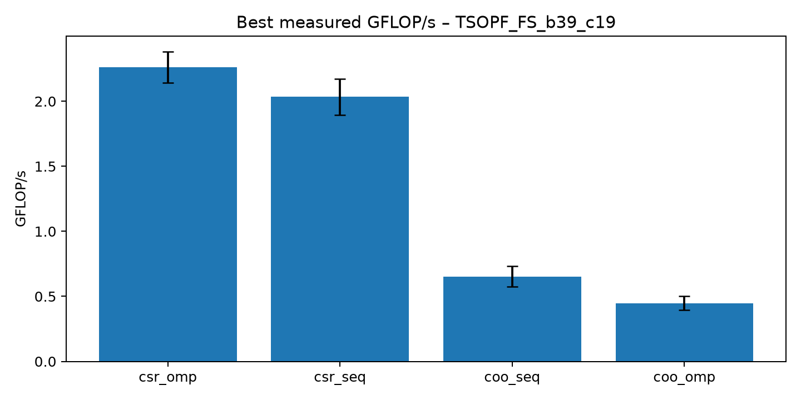
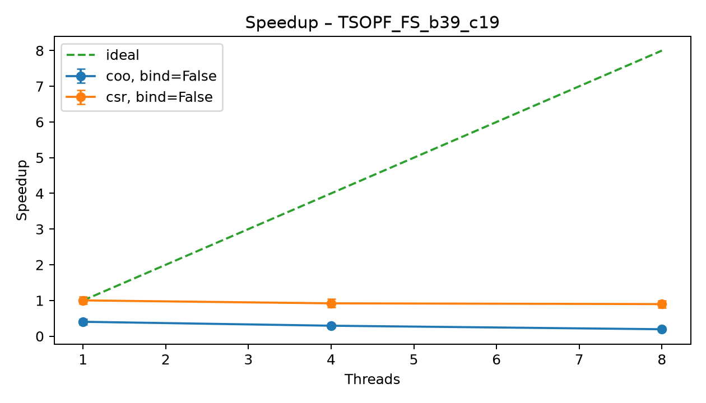
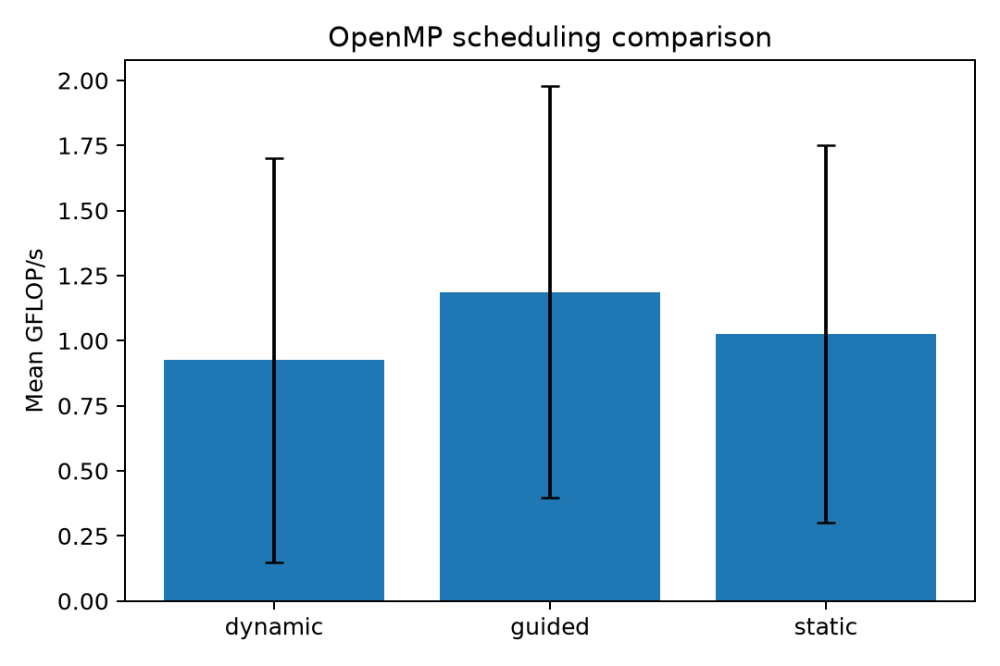
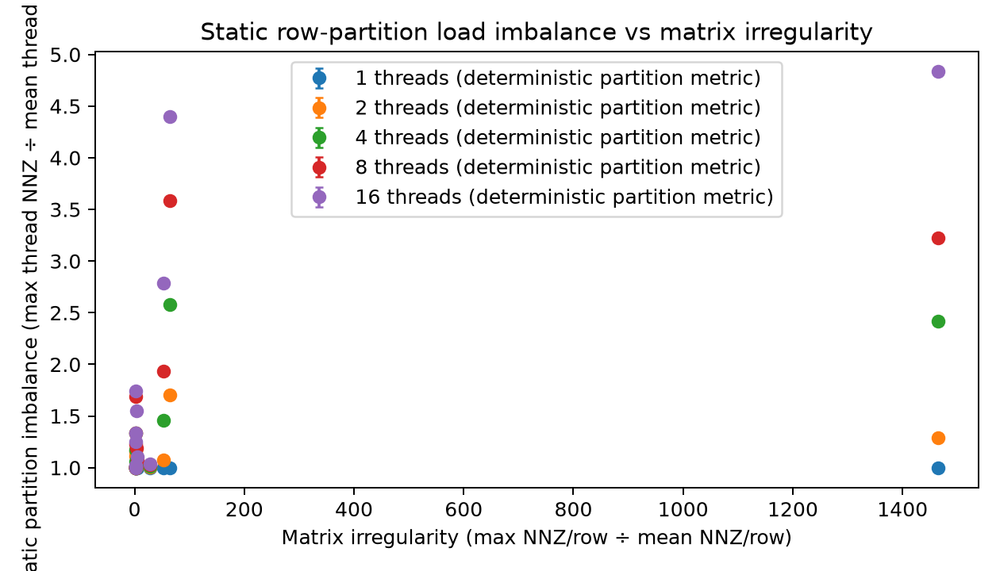
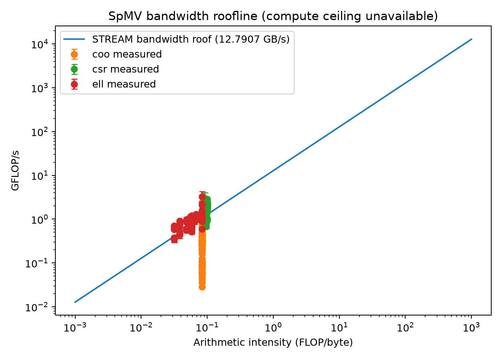

# Parallel Sparse Matrix–Vector Multiplication on a Multicore CPU
**Team 5 | Cluster B | Problem 5**

## 1. Objective

The objective was to implement and evaluate sparse matrix–vector multiplication (SpMV) using COO, CSR and ELL storage formats on a multicore CPU. Sequential and OpenMP implementations were compared across SuiteSparse matrices. The study examined scheduling policies, thread scaling, row-length irregularity, first-touch initialization, thread binding and memory-bandwidth limits.

## 2. Experimental setup

| Item | Configuration |
|---|---|
| CPU | Intel Core i5-1235U |
| Cores / logical processors | 10 / 12 |
| Cache | L2: 6656 KB; L3: 12288 KB |
| RAM | 16 GiB |
| OS | Windows 11 Home, 64-bit |
| Compiler | GCC 16.2.0, MSYS2 UCRT64 |
| OpenMP | `_OPENMP=202111` (OpenMP 5.2) |
| Build flags | `-O3 -fopenmp -Wall -Wextra` |
| Precision | Double precision |
| Threads | 1, 4 and 8 |
| Schedules | Static, dynamic and guided; chunk size 16 |
| Repetitions | 1 warm-up and 5 measured runs |

Thirteen SuiteSparse matrices were evaluated: appu, uni_chimera_i4, soc-sign-Slashdot090221, wy2010, mixtank_new, Goodwin_071, bbmat, ns3Da, sparsine, bcsstk35, av41092, TSOPF_FS_b39_c19 and qpband. Matrix Market inputs and deterministic saved vectors were used. The selected matrices include graph, CFD, structural, power-network, large and structured sparse cases.

STREAM used 50,000,000 elements per array and 10 timing iterations. Validation passed. The highest measured Triad bandwidth was **12.7907 GB/s at 6 threads**. This is measured bandwidth, not theoretical peak bandwidth.

## 3. Methodology

Matrix Market inputs were converted to COO, CSR and ELL representations. Each format was checked against a reference SpMV result before timing. SpMV performs approximately two floating-point operations per nonzero. COO parallel accumulation uses atomic updates because multiple nonzeros can contribute to the same output row. CSR and ELL use row-based OpenMP parallelism.

Static, dynamic and guided schedules were tested. ELL stores rows at a common width, so short rows can require padding up to the longest row. ELL was excluded for four matrices when the padding ratio exceeded 20. The main raw benchmark file contains 2,100 rows: 350 configurations with six observations each, including the warm-up. Processed summaries exclude warm-up observations.

## 4. Results

### Format performance

| Implementation | Mean GFLOP/s |
|---|---:|
| COO sequential | 1.2882 |
| COO OpenMP | 0.3072 |
| CSR sequential | 1.7972 |
| CSR OpenMP | 1.8731 |
| ELL sequential | 0.9937 |
| ELL OpenMP | 0.9192 |

CSR achieved the highest average throughput. OpenMP slightly improved the aggregate CSR mean, while the aggregate COO and ELL OpenMP means were lower than their sequential counterparts. The highest individual configuration was qpband ELL sequential at 3.2901 GFLOP/s. These averages combine different matrices and configurations and should not be interpreted as a controlled single-matrix comparison.

### Thread scaling

Per-matrix speedup was calculated against the sequential baseline for the same format. Scaling was not linear: the aggregate mean throughput across OpenMP configurations was 0.9241 GFLOP/s at one thread, 1.0819 GFLOP/s at four threads and 1.1326 GFLOP/s at eight threads.

### Scheduling

| OpenMP schedule | Mean GFLOP/s |
|---|---:|
| Dynamic | 0.9255 |
| Guided | 1.1865 |
| Static | 1.0265 |

Guided scheduling had the highest aggregate mean in this experiment. The comparison pools different matrices, formats and thread counts, so it is descriptive rather than a controlled comparison of scheduling policies on one fixed workload.

### Row-length irregularity and load balance

The ratio of maximum to mean nonzeros per row was used as a simple irregularity indicator. TSOPF_FS_b39_c19 had a ratio of approximately 1465.43, compared with approximately 1.81 for sparsine. Highly uneven row lengths can cause load imbalance under static row partitioning and increase ELL padding. The plotted load-imbalance metric is a deterministic static-partition estimate, not a direct runtime measurement.

### Roofline and memory bandwidth

The roofline figure uses the measured STREAM Triad bandwidth of 12.7907 GB/s. Arithmetic intensity is estimated using two FLOPs per nonzero and approximate bytes moved per nonzero for each storage format. These simplified traffic estimates do not fully model cache reuse or actual memory transactions. A compute ceiling is not shown because a defensible FP64 peak estimate was not established; this is therefore a bandwidth-only roofline.

## 5. Discussion

CSR was the strongest overall format in the measured averages. Its row-oriented structure avoids COO's atomic accumulation overhead and avoids ELL's fixed-width padding. COO is straightforward to store, but atomic updates can limit parallel performance. ELL can be effective when row lengths are similar; it is less suitable when a small number of rows are much longer than the rest.

Guided scheduling produced the highest pooled mean, although the best schedule can depend on matrix structure and format. Increasing the thread count improved aggregate throughput only modestly, indicating that parallel overhead and irregular memory access limit scaling.

Parallel first-touch initialization reduced initialization time in the recorded 50-million-element tests at 2–12 threads. For example, at four threads the measured time decreased from 98 ms to 61 ms. These measurements do not establish NUMA locality because the machine's NUMA topology and memory placement were not verified.

Thread binding was attempted on sparsine and TSOPF_FS_b39_c19. The GCC `libgomp` runtime reported “Affinity not supported on this configuration” when binding was enabled. Successful processor pinning was therefore not established, and no pinning benefit is claimed.

## 6. Conclusion and limitations

Sequential and OpenMP COO, CSR and ELL implementations were evaluated and checked against reference results on 13 SuiteSparse matrices. CSR achieved the highest aggregate mean throughput, and guided scheduling had the highest pooled scheduling mean. Performance varied with matrix structure and row-length distribution; additional threads did not produce linear scaling.

Limitations include unsupported thread affinity in the tested Windows runtime, unverified NUMA topology, simplified byte-traffic estimates, no established FP64 compute ceiling and no power measurements. ELL was excluded for four matrices because their padding ratio exceeded the configured threshold. These limitations are retained in the handoff documentation.
